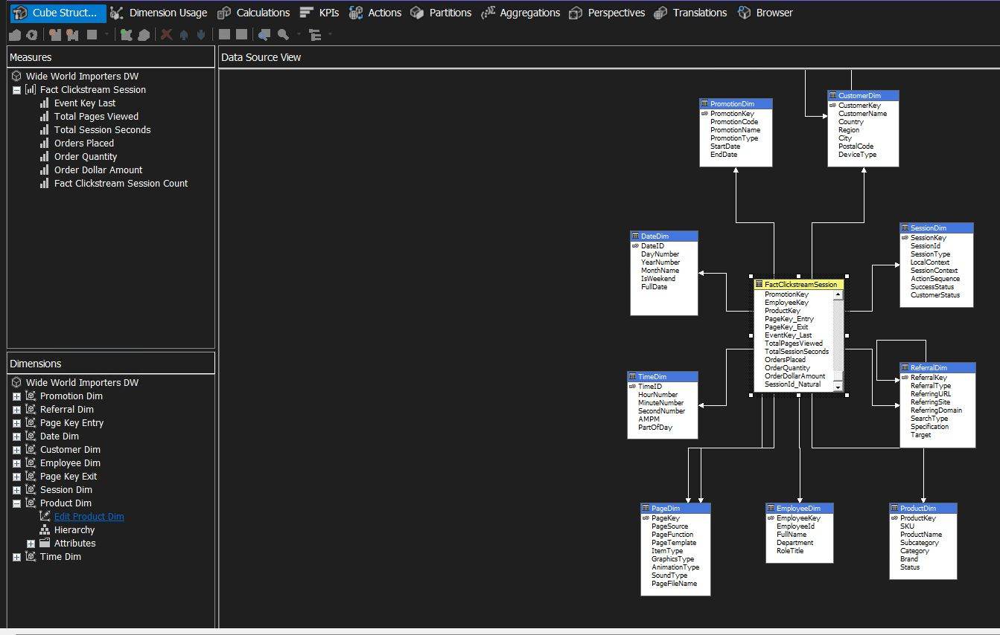
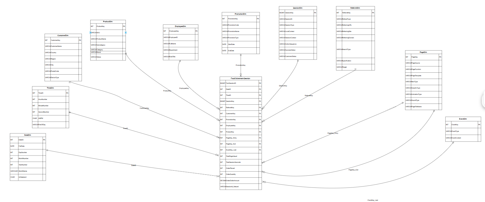
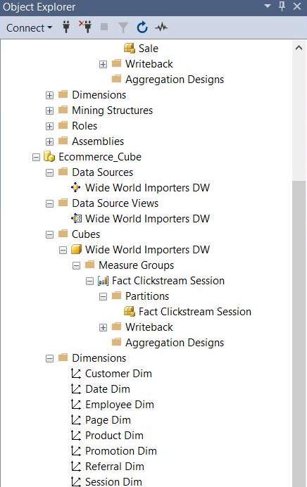

# E-commerce Clickstream Data Warehouse + SSAS Cube

A clickstream data warehouse on SQL Server and an SSAS multidimensional cube on top of it. It ties referral source, campaign and time to sessions, page views, orders and revenue, so you can slice and drill down without touching the transactional system.

Built on the **WideWorldImportersDW** database (all objects in `dbo`), following Kimball & Ross's clickstream model.



## What's inside

| Part | Details |
|---|---|
| **Star schema** | `FactClickstreamSession` + 10 dimensions: Date, Time, Customer, Product, Employee, Promotion, Page, Event, Session, Referral |
| **Grain** | One row per event within a session (timestamped) |
| **Measures** | Total Pages Viewed, Total Session Seconds, Orders Placed, Order Quantity, Order Dollar Amount, Session Count |
| **Indexed views** | `VDailySessionSummary` (daily totals) and `ProductSummary` (per-product totals), each with a unique clustered index |
| **Indexes** | Nonclustered indexes on `DateID`, `TimeID`, `SessionKey`, `ProductKey` |
| **History** | Type 2 slowly changing dimensions on descriptive attributes (e.g. customer region, product brand) |
| **Cube** | `Ecommerce_Cube`, SSAS Multidimensional, built in Visual Studio (SSDT), deployed and processed |

## Star schema



## The cube

Built in Visual Studio with SQL Server Data Tools:

1. **Data source** pointing at WideWorldImportersDW.
2. **Data source view** joining the fact table to all 10 dimensions.
3. **Dimensions** created from the data source view, with hierarchies and attribute relationships:

   | Dimension | Hierarchy |
   |---|---|
   | Date | Year → Month → Day → Full Date |
   | Time | Hour → Minute → Second |
   | Customer | Country → Region → City |
   | Product | Category → Subcategory → Product |

4. **Measure group** `Fact Clickstream Session` with the measures listed above, mapped to every dimension through regular relationships. Page has two roles in the cube, Page Key Entry and Page Key Exit.
5. **Deployed and processed** to Analysis Services, then browsed from SQL Server Management Studio.



## Questions it answers

- Which referral sources and campaigns bring in the most revenue?
- What is the conversion rate per product or category?
- When are the peak hours and days for traffic and orders?
- How long do sessions last, and where on the site do visitors drop off?

## Run it

Run the scripts in order against SQL Server (they target `WideWorldImportersDW`):

```
sql/01_create_tables.sql   -- dimensions, then the fact table
sql/02_sample_data.sql     -- sample rows
sql/03_indexed_views.sql   -- summary views + clustered indexes
sql/04_indexes.sql         -- nonclustered FK indexes
```

Then point an SSAS Multidimensional project at the database to build the cube.

## Tools

SQL Server · T-SQL · SQL Server Analysis Services (SSAS) · Visual Studio (SSDT) · SQL Server Management Studio

## Reference

Kimball, R., & Ross, M. (2013). *The Data Warehouse Toolkit* (3rd ed.). Wiley.
